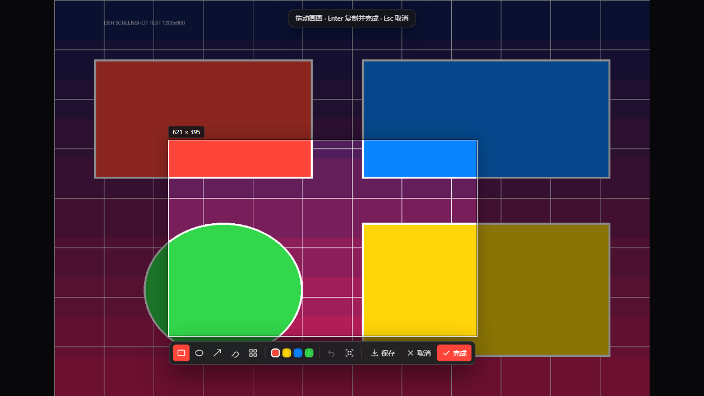
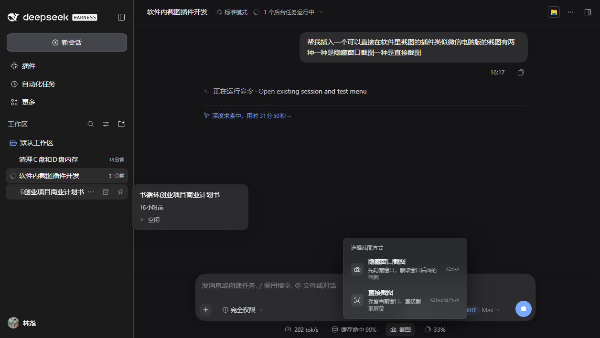

# 微信式截图 · WeChat-style Screenshot

> 在 Windows 上像微信/QQ 一样截图：隐藏窗口截取桌面，或直接截屏，框选、标注、复制、保存。





## 功能

- **隐藏窗口截图**：先把 Harness 窗口隐藏，截取它后面的桌面或其他软件，再恢复窗口进入框选。
- **直接截图**：保留当前窗口，直接截取当前屏幕再框选。
- 拖动框选，实时显示像素尺寸。
- 矩形、椭圆、箭头、画笔、马赛克标注，四种颜色，撤销、重选。
- 完成后自动保存一份到 `图片\Screenshots`，同时复制到系统剪贴板，在输入框按 `Ctrl+V` 粘贴。
- 保存到 `图片\Screenshots`，界面底部会显示完整路径。
- 多显示器下截取 Harness 所在的那块屏幕。
- 全局快捷键：`Alt+A` 隐藏窗口截图，`Alt+Shift+A` 直接截图，`Esc` 取消，`Enter` 复制并保存。

## 截图保存在哪

默认目录：`C:\Users\<用户名>\Pictures\Screenshots`（资源管理器里显示为“图片\Screenshots”）。

文件名：`DSH-Screenshot-YYYYMMDD-HHmmss.png`。

在文件资源管理器地址栏输入 `%USERPROFILE%\Pictures\Screenshots` 可直接打开。每次点“完成”都会自动保存一份，并在界面底部显示完整路径；点“保存”也会保存到同一目录。

如果系统把“图片”目录重定向到了 OneDrive，实际路径以截图完成时界面显示的路径为准。

## 系统要求

- Windows 10 / 11
- DeepSeek Harness 0.2.1 或更高（Desktop / Web 均可）
- 使用系统自带的 Windows PowerShell，无需安装额外依赖

## 安装

### 从 GitHub 安装

```sh
dsh plugin --profile web add github:tiamxiao/dsh-screenshot
```

安装后打开 Harness 的 **插件** 页面，启用 `dsh-wechat-screenshot`，然后刷新页面。

### 从本地目录安装

```sh
dsh plugin --profile web add file:C:\path\to\dsh-screenshot
```

同样在 **插件** 页面启用。

### 从 DSHHub 安装

上架后可在 DSH 的 **Settings → Plugin Market** 输入兑换码解锁并安装。

## 使用

1. 打开任意会话，点输入框右下角的「截图」按钮，或按快捷键。
2. 选择「隐藏窗口截图」或「直接截图」。
3. 拖动鼠标框选区域。
4. 用工具栏标注；按 `Enter` 或点「完成」会自动保存一份到 `图片\Screenshots`，并复制到剪贴板，回输入框按 `Ctrl+V` 粘贴。
5. 点「保存」也会写入 `图片\Screenshots`；`Esc` 或右上角 `×` 取消。

## 安全与隐私

- 只在用户主动点击「截图」或按快捷键时截屏。
- 截图只在本机处理：Host 用 Windows PowerShell 调用系统截图与剪贴板接口，不上传、不联网、无遥测。
- Host 路由要求 `x-dsh-screenshot: 1` 请求头，避免网页跨站触发。
- 截图会写入系统剪贴板；点击「完成」或「保存」时写入本机 `图片\Screenshots`。

## 兼容性

- 已在 DeepSeek Harness 0.2.1-rc.3（Windows Desktop）测试。
- 插件依赖 Electron 窗口与 Windows 桌面会话；Linux/macOS 不支持系统级截图。

## 许可证

[MIT](LICENSE)

## 问题反馈

请到 [GitHub Issues](https://github.com/tiamxiao/dsh-screenshot/issues) 提交，附上 Harness 版本、Windows 版本和复现步骤。
